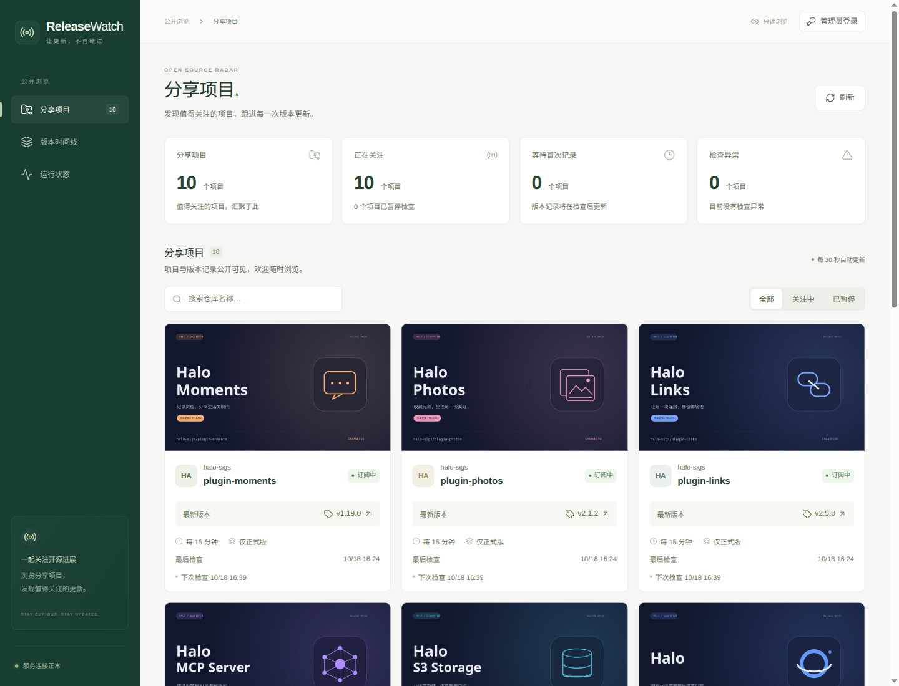

<div align="center">

# Release Watch

**关注开源项目的新版本，让重要更新及时抵达。**

[](https://github.com/Hanserwei/release-watch/actions/workflows/ci.yml)
[](package.json)
[](tsconfig.json)
[](src/web/App.tsx)
[](wrangler.jsonc)
[](migrations)

[架构](docs/architecture.md) · [架构图](docs/diagrams/system-overview.svg) · [贡献指南](CONTRIBUTING.md) · [安全策略](SECURITY.md)



</div>

Release Watch 订阅 GitHub 仓库的 Release，按设定频率检查新版本，并把发布说明投递到 Telegram。它运行在单个 Cloudflare Worker 上：Hono 负责 API，Vite + React 负责界面，D1（SQLite）负责状态，Cron Trigger 每分钟唤醒一次检查与投递。

- **版本基线**：首次检查只建立基线，不会把历史版本一次性推给订阅者；暂停期间升级为正式版的版本也不会补发。
- **可恢复的检查与投递**：项目、投递、Telegram 更新各自持有租约，实例重启或请求失败后自动续跑。
- **长文不截断**：发布说明按 Telegram 上限分段，封面与已发进度落库，恢复时从记录的偏移继续，已落库的封面与分段不会重发（发送成功但写库失败时仍可能重复，见[已知限制](#已知限制)）。
- **可选的中文摘要**：配置 DeepSeek 后附上中文要点；摘要失败时始终回退原文，不影响通知。
- **每日 AI 开发早报**：聚合 24 个 RSS/Atom 来源和 GitHub Trending，由 DeepSeek 过滤、中文摘要、六类分类与同事件去重，每天北京时间 08:30 推送。
- **Markdown 富文本推送**：早报使用加粗分类、可点击标题和重点标记；版本通知保留标题、列表、引用、代码和链接样式，图片说明也支持。emoji 根据新闻类别、重要程度、预发布状态及功能、修复、性能、安全等实际内容变化。长文按可见文字分段，格式与发送进度一并保存。
- **公开只读视图**：GitHub 上确认为公开的仓库，其项目与版本可在无口令下浏览；管理动作仍受口令保护。

## 架构总览

[](docs/architecture.md)

公开面板与管理员控制台是同一份 React 产物，由 Worker 的 `ASSETS` 提供；`/api/*` 与 `/telegram/webhook` 先进入 Hono。Cron 每分钟从 D1 领取到期项目、抓取 GitHub Release，再以出站队列的形式把通知推给 Telegram。项目、投递与 Webhook 更新各自用租约与条件更新防重入，全部状态都在一个 D1 库里。

完整的数据流、信任边界与失败路径见 [架构文档](docs/architecture.md)，从发现版本到图文发送的全过程见 [通知时序图](docs/diagrams/notification-flow.svg)。两张图均使用 [Archify](https://github.com/tt-a1i/archify) 绘制，附带源码引用、主题切换和动态连线；[架构总览 HTML](docs/diagrams/system-overview.html) 与 [通知流程 HTML](docs/diagrams/notification-flow.html) 请下载后用浏览器打开，GitHub 只展示 HTML 源码。

| 文档 | 内容 |
| --- | --- |
| [docs/architecture.md](docs/architecture.md) | [系统架构图](docs/diagrams/system-overview.svg)、信任边界、数据库表、版本检查、通知恢复与摘要失败路径 |
| [CONTRIBUTING.md](CONTRIBUTING.md) | 本地开发、目录结构、迁移与测试约定、提交前检查 |
| [SECURITY.md](SECURITY.md) | 漏洞报告、威胁模型、凭据存放与部署加固清单 |

## 快速开始（本地）

需要 Node.js ≥ 22（CI 使用 Node 24）与 pnpm（版本固定在 `package.json` 的 `packageManager`）。

```bash
git clone https://github.com/Hanserwei/release-watch.git
cd release-watch
pnpm install --frozen-lockfile
pnpm setup:local
pnpm dev
```

- `pnpm install --frozen-lockfile` 严格按 `pnpm-lock.yaml` 安装依赖。
- `setup:local` 从 `.dev.vars.example` 生成 `.dev.vars`（权限 `600`，不会提交），写入随机的 `ADMIN_TOKEN` 与 `TELEGRAM_WEBHOOK_SECRET`，补齐后续新增的可选键，并对本地 D1 执行迁移。
- `dev` 并行启动 Worker（`http://127.0.0.1:8787`，带 `--test-scheduled`）与 Vite（默认 `http://127.0.0.1:5173`，把 `/api` 与 `/telegram` 代理到 Worker），并且每分钟请求一次本地定时入口，用来模拟线上 Cron。

打开 `http://127.0.0.1:5173`，用 `.dev.vars` 里的 `ADMIN_TOKEN` 登录。新增订阅时服务端会先确认仓库可见性，所以在 `.dev.vars` 填入有仓库读取权限的 `GITHUB_TOKEN` 并重启 `pnpm dev` 之前，添加订阅会直接提示凭据缺失。

## 部署到 Cloudflare Workers

1. **创建数据库并回填 ID**。`pnpm run deploy` 会读取 `wrangler.jsonc` 的 `database_id`，若仍是占位值 `00000000-0000-0000-0000-000000000000` 就直接退出：

   ```bash
   pnpm exec wrangler login
   pnpm exec wrangler d1 create release-watch
   ```

   把输出的 UUID 写入 `wrangler.jsonc` 的 `d1_databases[0].database_id`。仓库里的值是原作者账号下的库，**必须换成你自己的**；`database_name` 也要与实际库名一致。脚本只校验它不是占位值，选错库不会被拦下。

2. **填写凭据**。`.dev.vars` 供 `pnpm secrets:upload`、`pnpm telegram:webhook` 与本地 `wrangler dev` 使用；这两个脚本在文件存在时读取它，否则回退到当前进程的环境变量。必备项见[配置](#配置)。

3. **上传密钥并部署**：

   ```bash
   pnpm secrets:upload
   pnpm run deploy
   ```

   `secrets:upload` 调用 `wrangler secret bulk`；`deploy` 先跑 `vite build`，再由 `scripts/deploy.mjs` 应用远端 D1 迁移并调用 `wrangler deploy`。

4. **注册 Telegram Webhook**。把站点根地址写入 `.dev.vars` 的 `APP_URL`（只供脚本使用，不会上传为 Worker 变量），或用 `--url` 传入，然后执行：

   ```bash
   pnpm telegram:webhook
   ```

   脚本要求地址是 HTTPS 根路径，然后调用 `setWebhook`，回调指向 `/telegram/webhook`，`allowed_updates` 只有 `message`。之后用白名单内的账号向机器人发送 `/start` 完成绑定。

> 手动部署也可以，但要按顺序：`pnpm build`（`wrangler.jsonc` 的 `ASSETS` 指向 `dist/`）、`pnpm db:remote`、`pnpm exec wrangler deploy`。这条路不会校验 `database_id`，也没有 `secrets:upload` 的字段检查。

## 配置

`wrangler.jsonc` 的 `vars` 只放两个非敏感的数量上限；其余全部通过 `wrangler secret` 注入。**例外是 DeepSeek 密钥**：如果在管理界面保存，它明文存在 D1 的 `settings.deepseek_api_key`（这也是"界面值优先于环境变量"的原因），详见 [SECURITY.md](SECURITY.md)。

| 名称 | 来源 | 必填 | 说明 |
| --- | --- | --- | --- |
| `ADMIN_TOKEN` | Secret | 是 | 管理接口的 Bearer 口令，至少 24 位。缺失或短于 24 位时所有**管理**接口返回 503；`/api/health` 与 `/api/public/dashboard` 仍可访问。 |
| `GITHUB_TOKEN` | Secret | 是 | 读取 Release 与仓库可见性。公开仓库只需只读权限；私有仓库需对该仓库具备 `Contents: Read`。 |
| `TELEGRAM_BOT_TOKEN` | Secret | 是 | Bot Token，用于发送通知与回复命令。 |
| `TELEGRAM_WEBHOOK_SECRET` | Secret | 是 | Webhook 校验密钥，24–256 位 `[A-Za-z0-9_-]`，与 `setWebhook` 的 `secret_token` 一致。 |
| `TELEGRAM_ALLOWED_USER_ID` | Secret | 是 | 唯一允许操作机器人的用户 ID（正整数）。 |
| `TELEGRAM_CHAT_ID` | Secret | 否 | 默认通知目标的后备值；数据库里的 `default_chat_id`（由 `/start` 写入）优先。 |
| `DEEPSEEK_API_KEY` | Secret（可选） | 早报必需，版本摘要可选 | 共用的 DeepSeek 密钥，20–200 位可见 ASCII。也可在管理界面配置；停用 DeepSeek 会暂停早报处理与发送。 |
| `POLL_BATCH_SIZE` | `vars` | 否 | 单次调度检查的项目数，未设置时为 3，取值被夹在 1–3。 |
| `DELIVERY_BATCH_SIZE` | `vars` | 否 | 单次调度发送的会话数，取值被夹为 1，即每次只推一条。 |

`secrets:upload` 在缺少任一必备项时中止，并校验口令长度、Webhook 密钥格式、用户 ID 格式与可选的 DeepSeek 密钥格式。所有校验只在失败时打印规则文本，不回显密钥内容。

<details>
<summary>各脚本实际需要的字段</summary>

| 命令 | 必需 | 可选 | 前置条件 / 行为 |
| --- | --- | --- | --- |
| `pnpm setup:local` | 无 | — | 需要 `.dev.vars.example`；自动生成 `ADMIN_TOKEN`、`TELEGRAM_WEBHOOK_SECRET`，补空可选键，应用本地迁移 |
| `pnpm secrets:upload` | `ADMIN_TOKEN`、`GITHUB_TOKEN`、`TELEGRAM_BOT_TOKEN`、`TELEGRAM_WEBHOOK_SECRET`、`TELEGRAM_ALLOWED_USER_ID` | `TELEGRAM_CHAT_ID`、`DEEPSEEK_API_KEY` | 需已登录 Wrangler；不检查 `POLL_BATCH_SIZE` / `DELIVERY_BATCH_SIZE`（它们在 `vars` 里） |
| `pnpm run deploy` | `wrangler.jsonc` 中真实的 `database_id` | — | 已登录 Wrangler 并上传凭据；命令会自行构建、迁移和部署 |
| `pnpm telegram:webhook` | `TELEGRAM_BOT_TOKEN`、`TELEGRAM_WEBHOOK_SECRET`、站点根地址 | — | 地址来自 `--url` 或 `APP_URL`，必须是 HTTPS 根路径 |

</details>

## 使用方式

管理界面有三个页面：**订阅管理**、**版本时间线**、**运行状态**。口令只保存在当前标签页的 `sessionStorage`；退出会清除当前会话，关闭标签页通常会清除浏览器保存的值。服务端口令仍有效，撤销访问需要轮换 `ADMIN_TOKEN`。

### 订阅与封面

在「订阅管理」点「添加订阅」，填 `owner/repo`（或完整 GitHub 仓库地址），选择是否包含预发布、检查频率（15 / 30 / 60 / 360 分钟）与封面：

- **封面可填内置路径**（如 `/covers/halo.png`）或**公开 HTTPS 图片地址**；新建时留空会自动套用内置封面（若该仓库有）。
- **换封面**：打开该订阅的「订阅设置」直接填新地址保存。封面属于项目，同一仓库的所有订阅共享同一张图。
- **清除封面**：把输入框清空后保存，通知恢复为纯文字发送。

### 中文摘要

1. 进入「运行状态」页，找到「DeepSeek 中文摘要」面板。
2. 粘贴 DeepSeek API Key（20–200 位可见 ASCII），点「保存密钥」——保存后不会回显，面板只显示「密钥来源：后台保存」。
3. 确认「启用中文摘要」开关已开启；首次保存密钥默认启用，之前主动停用过时需要重新打开。
4. 「清除密钥」会删除后台保存的值并重置开关；如果环境里配置了 `DEEPSEEK_API_KEY`，会回退到该密钥并默认启用，否则恢复为未配置状态。

摘要只是增强：调用失败、额度用尽、返回异常或超时（8 秒）时，通知直接附原文。

### 每日 AI 开发早报

本功能参考 [ai-news-bot](https://github.com/zzmlb/ai-news-bot) 的聚合与两阶段筛选流程，使用 DeepSeek `deepseek-chat` 完成相关性判断、中文摘要与话题去重，分类为编程工具、AI 模型、安全风险、行业洞察、开源项目、开发实践。

1. 部署前运行 `pnpm db:local` 更新本地数据库；`pnpm run deploy` 会自动应用远端新增的 `0004_news_digests.sql` 迁移。
2. 在「运行状态」配置并启用 DeepSeek，或设置 `DEEPSEEK_API_KEY`，再在 Telegram 私聊发送 `/start`，或在目标群发送 `/start@机器人用户名` 绑定通知目标。
3. 「每日早报」默认开启，可以在后台切换，也可以用 `/news on`、`/news off` 控制；`/news` 查看状态。

定时任务沿用现有的每分钟 Cron，无需再添加 UTC 定时表达式。每天 **北京时间 08:00** 开始，按每次 3 个来源、每个来源最多 4 条、每批 12 条分步整理，**08:30（UTC 00:30）** 起发送一条分类早报，最多 10 条，确保链接和单条内容完整。每期覆盖前一天 08:00 至当天 08:00，两个相邻日期的窗口连续，不会遗漏准备期间的半小时新闻；08:00 后发布的内容在下一期处理。GitHub Trending 明确标注为发现时间。采集列表见 [news-sources.ts](src/server/news-sources.ts)。

URL 去重会排除最近 30 天已推送的链接，DeepSeek 再合并同一期相同事件的报道。部分来源不可用时使用其余成功来源，全部失败则重试；模型不可用、响应不完整或分类错误时保存进度并退避重试，不推送未经整理的原始内容。每一步连续失败 8 次后暂停，可在后台点击「重试本期」。无相关资讯时记录为空期，不发送消息。

如果 08:00 后才启动或恢复服务，会补做当天准备，并在完成后补推，因此异常情况下可能晚于 08:30；不会补发往日期次。后台展示最近一期的分类内容、处理进度和来源失败数量。DeepSeek 的开关与版本摘要共用，关闭后早报也暂停；新闻独立开关只影响早报。准备内容与投递状态存于 D1，API 和日志不包含密钥。Telegram 已收取消息但写库失败时仍存在重复发送的可能。

### Telegram 命令

| 命令 | 作用 |
| --- | --- |
| `/start` | 绑定默认通知目标并接管未绑定订阅；群内绑定还会开启所有活跃版本订阅的群组同步，保留原会话投递 |
| `/sub owner/repo [--pre]` | 订阅仓库；`--pre` 同时关注预发布 |
| `/unsub owner/repo` | 取消当前会话对该仓库的订阅 |
| `/list` | 私聊列出当前会话订阅；同步群列出实际同步的活跃项目，最多显示 20 条 |
| `/status` | 查看凭据配置、绑定状态与投递计数 |
| `/news [on\|off]` | 查看早报状态，或控制每日北京时间 08:30 新闻推送 |
| `/help` | 查看命令帮助 |

普通群和超级群支持推送。将机器人加入目标群并允许发言，使用 `TELEGRAM_ALLOWED_USER_ID` 对应的个人账号，在群里发送 `/start@机器人用户名`。群内其他命令也必须指定机器人，例如 `/news@机器人用户名 on`；无需关闭 Telegram 隐私模式，普通群成员和匿名管理员的命令会被忽略。绑定群组后，早报与以后新建的网页订阅发送到该群；所有现有及新增的活跃版本订阅，也会在保留原会话投递的同时向该群同步，无需逐个重新订阅。相同版本在同一群中只生成一份投递，原订阅的暂停、预发布过滤与恢复基线规则仍然有效。首次启用或更换同步群只处理此后更新，不补发历史版本；重复绑定同一群不会重置基线。再次私聊 `/start` 不会关闭已绑定群的版本同步，`/status` 可查看同步状态。

<details>
<summary>HTTP 接口一览</summary>

除 `GET /api/health`、`GET /api/public/dashboard` 与 `/telegram/webhook` 外，其余接口都要求 `Authorization: Bearer <ADMIN_TOKEN>`。管理接口请求体上限 16 KB，响应带 `Cache-Control: no-store` 与 `nosniff`。

| 方法与路径 | 鉴权 | 说明 |
| --- | --- | --- |
| `GET /api/health` | 公开 | 存活探针，返回 `{ "ok": true }` |
| `GET /api/public/dashboard` | 公开 | 公开项目、最近 50 条版本与汇总状态 |
| `GET /api/dashboard` | 口令 | 订阅列表、最近 50 条版本、运行状态 |
| `POST /api/subscriptions` | 口令 | 新增订阅（`repo` 必填，可选 `includePrerelease`、`intervalMinutes`、`coverUrl`） |
| `PATCH /api/subscriptions/:id` | 口令 | 修改预发布、间隔、暂停、封面（`coverUrl: null` 表示移除） |
| `DELETE /api/subscriptions/:id` | 口令 | 删除订阅及其未发送通知 |
| `GET /api/settings/deepseek` | 口令 | 返回 `configured`、`enabled`、`model`、`source`，不含密钥 |
| `PATCH /api/settings/deepseek` | 口令 | 保存、启用/停用或清除密钥（`apiKey: ""` 表示删除后台值并回退环境变量） |
| `POST /api/projects/:id/check` | 口令 | 立即检查该项目并触发一次投递 |
| `POST /api/deliveries/retry` | 口令 | 把失败通知重置为待发送 |
| `GET /api/news` | 口令 | 早报开关、准备条件、最近一期状态及分类内容 |
| `PATCH /api/settings/news` | 口令 | 切换早报，正文为 `{ "enabled": true }` 或 `false` |
| `POST /api/news/retry` | 口令 | 重试当天已达失败上限的早报；已发送的期次不会重新推送 |
| `POST /telegram/webhook` | Telegram 密钥 | 回调入口，仅接受 `message` 更新 |

HTTP 新增订阅不接受 `chatId`：接口会丢弃该字段，聊天目标由 `/start` 绑定或 `TELEGRAM_CHAT_ID` 决定。

</details>

<details>
<summary>pnpm 脚本</summary>

| 脚本 | 说明 |
| --- | --- |
| `pnpm setup:local` | 生成 `.dev.vars` 并对本地 D1 应用迁移 |
| `pnpm dev` | 并行启动 Worker 与 Vite，并模拟每分钟调度 |
| `pnpm build` | 构建前端到 `dist/`（Worker 直接引用该目录作为静态资源） |
| `pnpm typecheck` | 分别检查前端与 Worker 两套 `tsconfig` |
| `pnpm test` | 用 Vitest + Cloudflare 插件在 workers 运行时执行测试 |
| `pnpm check` | 依次执行 typecheck、test、build（CI 使用同一条命令） |
| `pnpm db:local` | 对本地 D1 应用迁移；远端用 `pnpm db:remote` |
| `pnpm run deploy` | 构建、应用远端迁移、部署 Worker |
| `pnpm secrets:upload` | 按 `.dev.vars`（或进程环境变量）批量上传 Worker 密钥 |
| `pnpm telegram:webhook` | 注册 Telegram Webhook |

</details>

## 已知限制

- **恢复不保证绝对不重复**。进度按"已成功写入数据库的发送"记录：如果 Telegram 实际收到但本地写库失败或请求超时，同一段消息会在下次重发。反过来，正文不会因分段而丢失。
- **多段通知可能被插入**：同一聊天同一时刻只能有一个发送方，但长通知按每分钟一批推进，期间可能插入其他版本的通知或命令回复，不保证一个版本的所有分段连续到达。
- **首次检查只建立基线**：订阅前的历史版本不会补发通知，但会在后台逐页补录到时间线。
- **公开面板不可按项目单独关闭**：只要仓库在 GitHub 上公开，订阅后其版本就会出现在公开页。关掉 `workers_dev` 只是换入口、不是访问控制——要真正限制访问，请在前置层加认证（如 Cloudflare Access）。
- **中文摘要密钥以明文存于 D1**（仅当在管理界面保存时）；请限制 Cloudflare 账号与 D1 访问权限，或只用 Secret 配置密钥。

## 安全

凭据以 Worker Secret 形式下发（DeepSeek 若在界面保存则例外，见上文），接口与日志都不回显密钥；公开面板只展示最近一次检查确认公开的仓库。威胁模型、报告渠道与加固清单见 [SECURITY.md](SECURITY.md)；改动流程与测试约定见 [CONTRIBUTING.md](CONTRIBUTING.md)。
